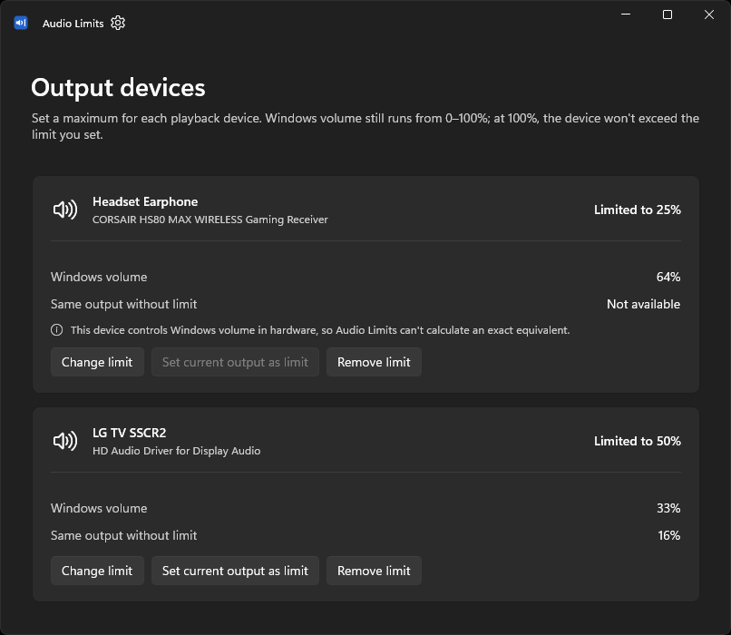

# Audio Limits [](https://github.com/MicaLovesKPOP/AudioLimits/releases/latest)

Audio Limits is a small Windows utility for setting a quieter maximum for each playback device while leaving the normal Windows volume slider at 0–100%.

It uses [Equalizer APO](https://sourceforge.net/projects/equalizerapo/) as the persistent attenuation backend. Once a limit is configured, Equalizer APO keeps it applied even when Audio Limits itself is not open.



## Download

Choose one of two downloads:

### `AudioLimits-Setup.exe` — recommended

Recommended for most users.

- choose **Just for me** or **Anyone who uses this computer**;
- supports update and repair when Setup is run again;
- creates the normal Start-menu / Installed Apps integration;
- prepares missing prerequisites on first setup;
- uninstalls through **Windows Settings → Apps → Installed apps**.

### `AudioLimits-1.0.0-x64.zip` — no installation

For people who prefer extract-and-run software.

1. Extract the complete **Audio Limits** folder.
2. Run `AudioLimits.exe` from the extracted folder.

Supporting application files are kept under `app\`.

The ZIP is extract-and-run, but not fully portable: settings are stored in your normal Windows user profile, and enabling Start with Windows creates normal Windows integration. Copying the whole folder to another x64 Windows PC is supported.

## Requirements

- Windows 10 version 2004 (build 19041) or newer.
- x64 Windows.

Audio Limits uses the .NET 8 Desktop Runtime, the Microsoft Visual C++ x64 runtime, Windows App Runtime 2.3.1, and Equalizer APO. Users normally do **not** need to install these manually: the setup/recovery flow detects what is missing, downloads it from its official source, verifies the downloaded installer, and installs only what is needed.

Equalizer APO playback-device selection remains an explicit user step. After Equalizer APO is installed, Audio Limits guides you to choose the playback devices it should control.

## What it does

- Configure a maximum output level independently for each playback endpoint.
- Keep the Windows volume slider usable across its full 0–100% range beneath that limit.
- Show the equivalent uncapped output when it can be calculated.
- Handle hardware-linked volume devices conservatively when exact equivalence is not available.
- Persist limits through Equalizer APO.
- Reconcile saved settings with the active audio configuration on startup.
- Run in the notification area, with optional Start with Windows behavior.
- Provide a modern WinUI 3 interface with light/dark/high-contrast support.

## Important limitation

Audio Limits is a convenience/safety aid, **not a hearing-protection guarantee**. Software or playback paths that bypass Equalizer APO can also bypass an Audio Limits cap. Hardware volume behavior varies by device.

## Building from source

Requirements for development:

- Windows 10/11 x64;
- .NET 8 SDK;
- internet access for NuGet restore;
- Inno Setup 6+ for the installer. `build.ps1` can install it with WinGet when available.

Run:

```text
Build-PreRelease.cmd
```

The build:

1. closes any running Audio Limits processes;
2. restores the solution;
3. runs the test suite;
4. builds the WinUI app and prerequisite launcher;
5. assembles the application folder;
6. builds the normal Setup;
7. builds the no-install x64 ZIP.

The `release\` directory contains the two distributable files. Intermediate build output and `RELEASE_REPORT.txt` are stored under `artifacts\`. `publish\` contains an unzipped copy of the application folder for local testing.

## Repository structure

- `src/AudioLimits.Core` — limiter, persistence, Equalizer APO and audio-device logic.
- `src/AudioLimits.App` — WinUI 3 application.
- `src/AudioLimits.Launcher` — self-contained prerequisite/recovery launcher.
- `tests/AudioLimits.Core.Tests` — regression tests for the limiter and settings behavior.
- `installer/AudioLimits.iss` — Inno Setup installer.
- `docs/` — design and verification documentation.